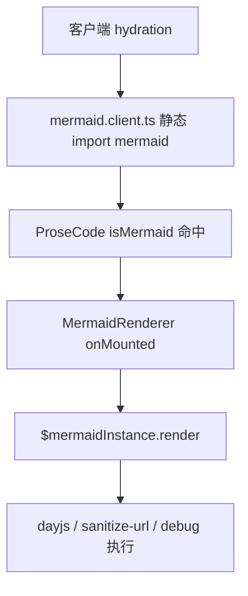

# 绿色控制组

控制组的核心 Nuxt 3 依赖被精确固定：

```json
{
	"nuxt": "3.21.2",
	"shadcn-docs-nuxt": "1.1.9",
	"@ztl-uwu/nuxt-content": "2.13.9",
	"h3": "1.15.11"
}
```

根 workspace 另外固定 `nuxt-og-image` 到 Nuxt 3 已验证线，并固定 Content 版本，防止初始化阶段就发生实验目标之外的漂移。

这些版本只代表本仓 control，不代表生态唯一正确版本。

## 复现触发块（R31-family / F30）

以下 mermaid 代码块用于复现 F30（ESM/CJS 入口冲突导致 hydration 中断）。它是本实验唯一的单变量：插入 ` ```mermaid ` 块后，`ProseCode.vue` 的 `isMermaid` 命中，渲染 `MermaidRenderer.vue`，其 `onMounted` 在客户端调用 `$mermaidInstance.render()`，从而把 mermaid 及其传递依赖（dayjs / @braintree/sanitize-url / debug）拉入客户端执行路径。


